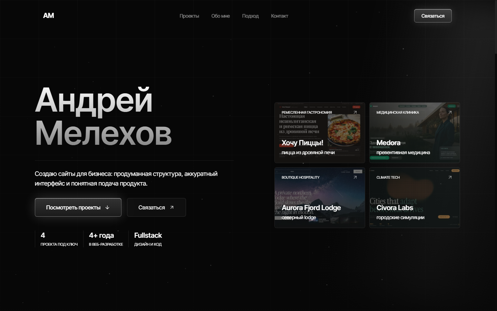
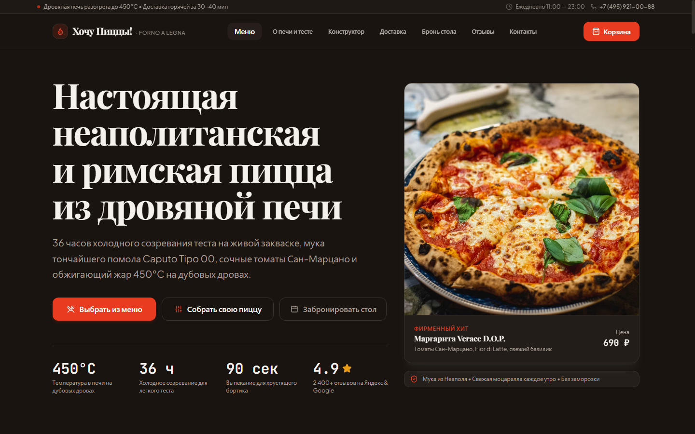
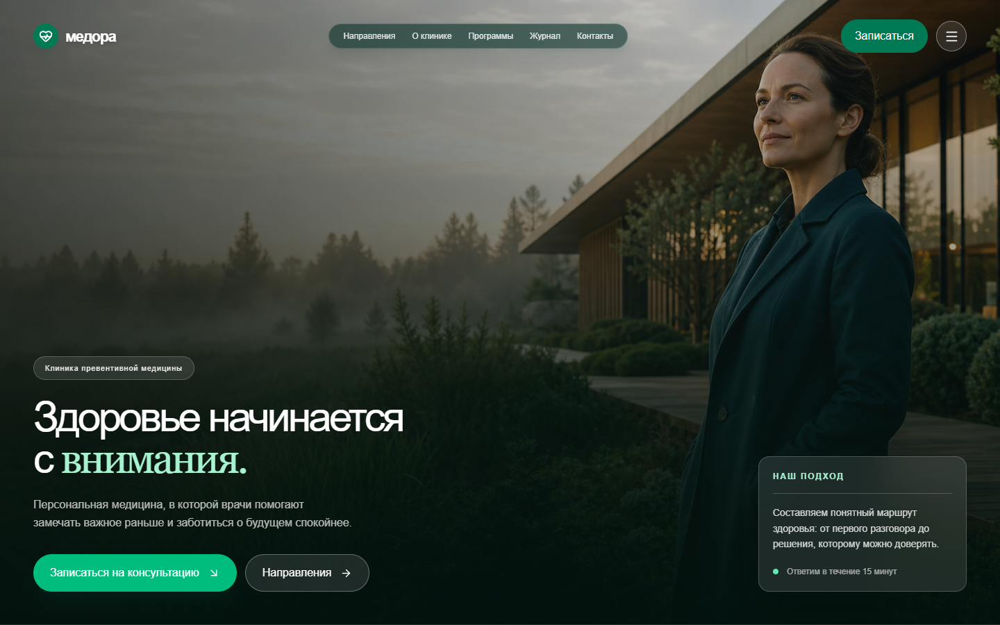
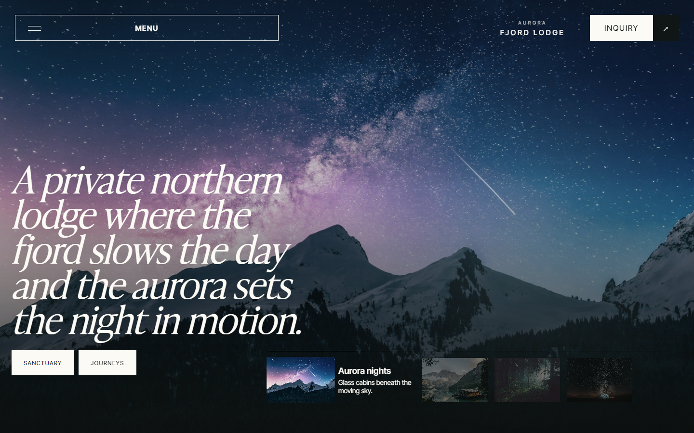
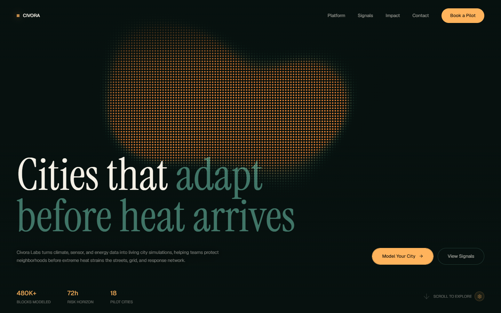

# Andrey Melekhov Portfolio

A dark, responsive portfolio website for presenting selected web projects, development approach, and contact options for potential clients.

[View Live Website](https://melekhovv-my-portfolio.layero.app/)



## Overview

This portfolio is designed to make the first screen useful within a few seconds: visitors can see the developer name, key positioning, project previews, and direct contact actions without digging through the page.

The site focuses on:

- a strong first-screen portfolio presentation;
- clean dark visual language with luminous frosted glass accents;
- responsive layouts for desktop and mobile;
- animated interactions powered by Framer Motion;
- case preview cards and detailed project modal sections;
- a clear contact call to action.

## Featured Projects

| Project | Live Demo | Stack |
| --- | --- | --- |
| **Хочу Пиццы!**<br>Artisanal Neapolitan & Roman pizza delivery website | [Live Demo](https://simple-spruce-st7nd1qq.preview.layero.app/) | React, TypeScript, Tailwind CSS, Motion |
| **Medora Medical Platform**<br>Preventive healthcare clinic website | [Live Demo](https://melekhovv-medora-medicine-website.layero.app/) | Next.js, TypeScript, Tailwind CSS, Framer Motion |
| **Aurora Fjord Lodge**<br>Nordic boutique hospitality & retreat booking | [Live Demo](https://melekhovv-aurora-fjord-lodge.layero.app/) | Next.js, TypeScript, Tailwind CSS, Framer Motion |
| **Civora Labs**<br>Climate tech platform for urban simulation | [Live Demo](https://melekhovv-civora-labs-site.layero.app/) | Next.js, TypeScript, Tailwind CSS, Data UI |

<p align="center">
  
  
</p>
<p align="center">
  
  
</p>

## Tech Stack

| Area | Technology |
| --- | --- |
| Framework | Next.js 14 |
| UI | React 18 |
| Language | TypeScript |
| Styling | Tailwind CSS |
| Animation | Framer Motion |
| Icons | Lucide React |
| Package Manager | npm |

## Features

- Responsive hero section with featured project cards.
- White cursor glow and hover spotlight effects on interactive elements.
- Hero-only particle background.
- Project grid with modal-style case details.
- About, approach, CTA, and footer sections.
- Mobile-friendly navigation and layouts.
- Production-ready Next.js build.

## Live Demo

The published website is available here:

**https://melekhovv-my-portfolio.layero.app/**

## Getting Started

Clone the repository:

```bash
git clone https://github.com/melekhovv/my-portfolio.git
cd my-portfolio
```

Install dependencies:

```bash
npm install
```

Run the development server:

```bash
npm run dev
```

Open the local site:

```text
http://localhost:3000
```

## Available Scripts

```bash
npm run dev
npm run build
npm run start
npm run lint
```

## Project Structure

```text
public/
  portfolio-preview.png
  projects/
    hochu-pizza-desktop.png
    hochu-pizza-mobile.png
    medora-desktop.png
    medora-mobile.png
    aurora-fjord-lodge-desktop.png
    aurora-fjord-lodge-mobile.png
    civora-labs-desktop.png
    civora-labs-mobile.png
src/
  app/
  components/ui/
  data/
  lib/
```

## Contact

- GitHub: [melekhovv](https://github.com/melekhovv)
- Telegram: [@melekhovv](https://t.me/melekhovv)
- Email: anrewje@gmail.com

## License

This project is licensed under the MIT License.
